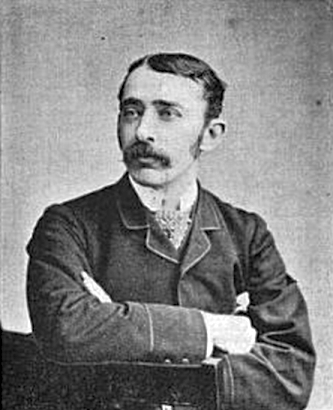

# John Ambrose Fleming

**Born:** 29 November 1849

**Died / status:** 18 April 1945

**Fields:** Thermionic emission, Radio physics, Electrical technology

For the image’s date, creator and attribution, see its source record.

## Biography

Fleming was a British electrical engineer and physicist who studied with Maxwell and became a professor at University College London. As an adviser to Edison and Marconi enterprises, he applied thermionic emission to radio detection and helped establish vacuum-tube electronics.

## Major contributions to physics

- Developed the Fleming thermionic valve for rectification and detection
- Investigated high-frequency signal reception and radio instruments
- Advanced university electrical-engineering education and teaching rules for electromagnetic directions

## Historical and source notes

- Included as an engineer and inventor for important electromagnetic or electronic experimental contributions; these technologies developed through the work of multiple pioneers.

## Image source and rights

- Source: [Original image record](https://commons.wikimedia.org/wiki/File:John_Ambrose_Fleming_1890.png)
- Creator / attribution: JDR
- License or rights statement: Public domain
- Local image: [98a865c26e200ad03462-f56402ab52.png](../portraits/98a865c26e200ad03462-f56402ab52.png)
- Credit: Electrical world. (1890). Vol XVL No 10 New York McGraw-Hill page 330

## Sources

- [John Ambrose Fleming — Magnet Academy, National High Magnetic Field Laboratory](https://maglabweb.magnet.fsu.edu/magnet-academy/history-of-electricity-magnetism/pioneers/john-ambrose-fleming/)
- [John Ambrose Fleming — Wikipedia biography](https://en.wikipedia.org/wiki/John_Ambrose_Fleming)
- [The birth of electronics — University College London](https://www.ucl.ac.uk/made-at-ucl/stories/birth-electronics-we-know-it)

Record reviewed: 2026-10-26.
