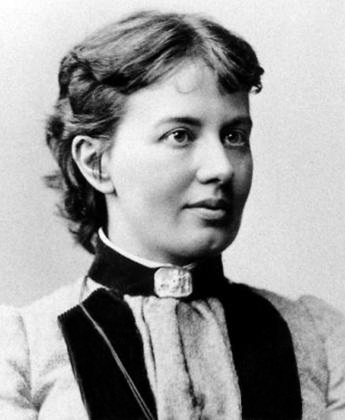

# Sofya Kovalevskaya

**Born:** 15 January 1850

**Died / status:** 10 February 1891

**Fields:** Mathematical physics, Classical mechanics

For the date, creator, form and attribution of this image, see its source record.

## Biography

Kovalevskaya was a Russian-born mathematician who pursued advanced study in Germany when women faced major educational barriers, and later taught in Stockholm. Her research on differential equations and rigid-body motion produced an important integrable case in analytical mechanics.

## Major contributions to physics

- Discovered the integrable rigid-body case known as the Kovalevskaya top
- Developed existence theory for analytic partial differential equations associated with the Cauchy–Kovalevskaya theorem
- Applied advanced analysis to classical mechanics and wave problems

## Historical and source notes

- Dates are given in the Gregorian calendar.
- Old Style Russian dates differ by several days.

## Image source and rights

- Source: [Original image record](https://commons.wikimedia.org/wiki/File:Sofja_Wassiljewna_Kowalewskaja_1.jpg)
- Creator / attribution: Unknown author
- License or rights statement: [Public domain](https://commons.wikimedia.org/wiki/File:Sofja_Wassiljewna_Kowalewskaja_1.jpg)
- Local image: [f6c3868821398d1a1ee1.jpg](../portraits/f6c3868821398d1a1ee1.jpg)
- Credit: http://www.goettinger-tageblatt.de/newsroom/wissen/dezentral/wissenlokal/art4263,603649

## Sources

- [Sofya Kovalevskaya — MacTutor, University of St Andrews](https://mathshistory.st-andrews.ac.uk/Biographies/Kovalevskaya/)
- [Sofya Kovalevskaya — Wikipedia — dates and biographical overview](https://en.wikipedia.org/wiki/Sofya_Kovalevskaya)

Record reviewed: 2026-10-26.
