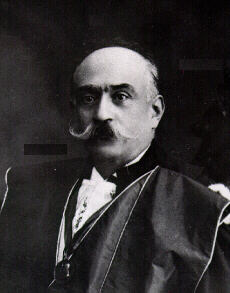

# Augusto Righi

**Born:** 27 August 1850

**Died / status:** 8 June 1920

**Fields:** Electromagnetic waves, Magneto-optics, Experimental physics

For the image’s date, creator, form and attribution, see its source record.

## Biography

Righi was an Italian experimental physicist trained in engineering and based for much of his career in Bologna. His improved spark oscillators and short-wavelength electromagnetic experiments influenced early radio work, while his magneto-optical research and institution building strengthened Italian physics.

## Major contributions to physics

- Generated short-wavelength electromagnetic waves and studied their reflection, interference and polarization
- Investigated magnetic effects on light and thermoelectric transport
- Developed precision apparatus and helped build Italian electromagnetic research

## Image source and rights

- Source: [Original image record](https://commons.wikimedia.org/wiki/File:Augusto_Righi.jpg)
- Creator / attribution: Unknown author
- License or rights statement: [Public domain](https://commons.wikimedia.org/wiki/File:Augusto_Righi.jpg)
- Local image: [17596eec7b10d6dddf05-e254397c26.jpg](../portraits/17596eec7b10d6dddf05-e254397c26.jpg)
- Credit: Unknown sourceUnknown source

## Sources

- [Augusto Righi — University of Bologna Historical Archives](https://archiviostorico.unibo.it/it/patrimonio-documentario/ritratti-di-docenti?record=27562)
- [Augusto Righi — Wikipedia biography](https://en.wikipedia.org/wiki/Augusto_Righi)

Record reviewed: 2026-10-26.
