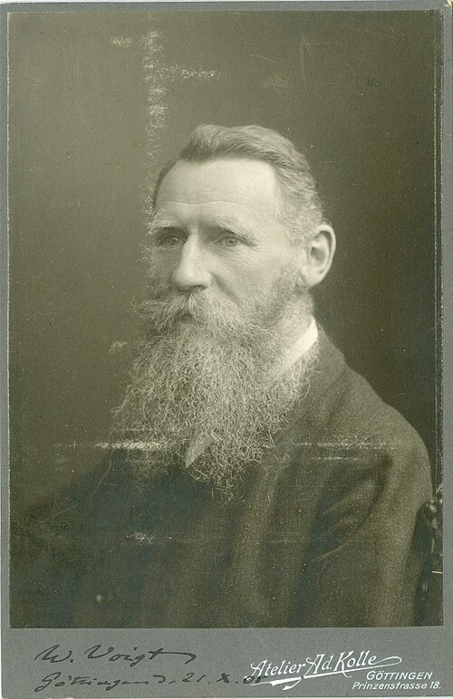

# Woldemar Voigt

**Born:** 2 September 1850

**Died / status:** 13 December 1919

**Fields:** Crystal physics, Elasticity, Spectroscopy

For the image’s date, creator, form and attribution, see its source record.

## Biography

Voigt was a German physicist who trained with Franz Neumann and worked in Königsberg and Göttingen. He related crystal symmetry to elastic, electrical and optical behaviour and taught researchers including Drude, Pockels and Ritz, helping establish crystal physics.

## Major contributions to physics

- Developed tensor and symmetry descriptions of anisotropic crystal properties
- Investigated elasticity, piezoelectricity and magneto-optical phenomena
- Provided theoretical tools including the Voigt spectral-line profile

## Image source and rights

- Source: [Original image record](https://commons.wikimedia.org/wiki/File:Woldemar_Voigt%2C_c._1908.jpg)
- Creator / attribution: unknown
- License or rights statement: [Public domain](https://commons.wikimedia.org/wiki/File:Woldemar_Voigt%2C_c._1908.jpg)
- Local image: [bbd8fbb65d18747dedee-1e489d0727.jpg](../portraits/bbd8fbb65d18747dedee-1e489d0727.jpg)
- Credit: https://miesiecznik.forumakademickie.pl/czasopisma/fa-1-2022-3/woldemar-voigt-i-polacy%E2%80%A9/

## Sources

- [Woldemar Voigt — Neue Deutsche Biographie](https://www.deutsche-biographie.de/117478008.html)
- [Woldemar Voigt — Wikipedia biography](https://en.wikipedia.org/wiki/Woldemar_Voigt)

Record reviewed: 2026-10-26.
