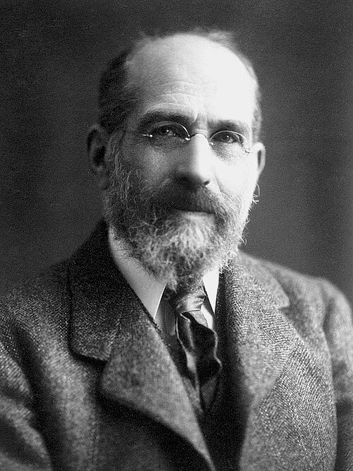

# Arthur Schuster

**Born:** 12 September 1851

**Died / status:** 14 October 1934

**Fields:** Spectroscopy, Gas discharges, Geophysics

For the image’s date, creator, form and attribution, see its source record.

## Biography

Schuster was a German-born British physicist based in Manchester. He investigated discharges, spectra, solar phenomena and geomagnetism, while building laboratories and research training. His scientific and organizational work helped professionalize British physics.

## Major contributions to physics

- Investigated gas discharges and atomic spectra
- Developed approximate treatments of radiative transfer in spectroscopy
- Studied geomagnetism and solar phenomena and built experimental research facilities in Manchester

## Image source and rights

- Source: [Original image record](https://commons.wikimedia.org/wiki/File:Arthur_Schuster.jpg)
- Creator / attribution: Unknown author
- License or rights statement: [Public domain](https://commons.wikimedia.org/wiki/File:Arthur_Schuster.jpg)
- Local image: [7cd565e44af6ef27ba57-e6a4177a29.jpg](../portraits/7cd565e44af6ef27ba57-e6a4177a29.jpg)
- Credit: [1]

## Sources

- [Arthur Schuster — University of Manchester](https://www.ww1.manchester.ac.uk/arthur-schuster/)
- [Arthur Schuster — Wikipedia biography](https://en.wikipedia.org/wiki/Arthur_Schuster)

Record reviewed: 2026-10-26.
