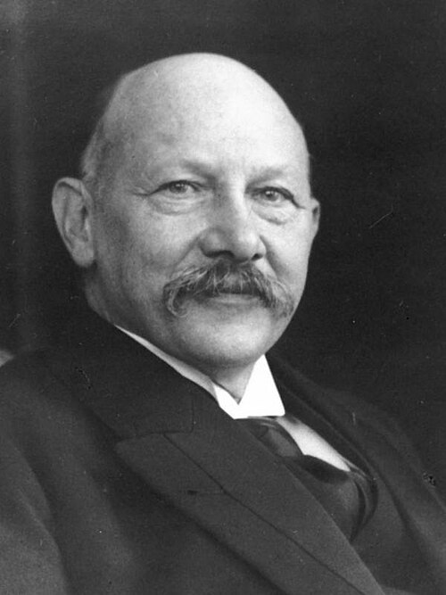

# Heike Kamerlingh Onnes

**Born:** 21 September 1853

**Died / status:** 21 February 1926

**Fields:** Low-temperature physics, Superconductivity

For the photographer or artist, date and type of image, consult the original image record.

## Biography

Heike Kamerlingh Onnes was born in Groningen, the Netherlands and conducted research in low-temperature physics and superconductivity. Nobel records list Leiden University as the affiliation at the time of the award. They liquefied helium and extended experiments to lower temperatures. They were awarded the Nobel Prize in Physics in 1913.

## Major contributions to physics

- Liquefied helium and extended experiments to lower temperatures
- Discovered the disappearance of electrical resistance in cold mercury

**Nobel Prize in Physics:** 1913

## Image source and rights

- Source: [Original image record](https://commons.wikimedia.org/wiki/File:Kamerlingh_portret.jpg)
- Creator / attribution: Unknown author
- License or rights statement: Copyrighted free use
- Local image: [80d072f797a91b5dd21c.jpg](../portraits/80d072f797a91b5dd21c.jpg)
- Credit: http://www.kb.nl/hkc/nobel/onnes/onnes.html . Further source: (cropped to 600×800), Museum Boerhaave, http://www.museumboerhaave.nl/contact/pers2a.html

## Sources

- [Heike Kamerlingh Onnes - Facts](https://www.nobelprize.org/prizes/physics/1913/onnes/facts/)
- [Nobel Prize official laureate API, id 18](https://api.nobelprize.org/2.1/laureate/18)
- [Wikipedia: Heike Kamerlingh Onnes](https://en.wikipedia.org/wiki/Heike_Kamerlingh_Onnes)

Record reviewed: 2026-10-26.
