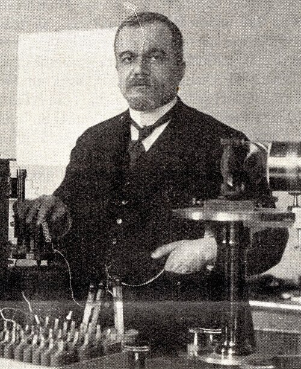

# Louis Georges Gouy

**Born:** 19 February 1854

**Died / status:** 27 January 1926

**Fields:** Optics, Interface physics, Magnetism

For the image’s date, creator, form and attribution, see its source record.

## Biography

Gouy was a French physicist at Lyon whose work spanned optics, electromagnetism and thermodynamics. He investigated phase changes in focused light, ionic distributions near interfaces, magnetism and microscopic motion, combining theory with precision instruments.

## Major contributions to physics

- Identified the additional phase shift near an optical focus
- Developed diffuse electrical-double-layer theory
- Introduced the Gouy balance for magnetic-susceptibility measurements and investigated Brownian motion

## Image source and rights

- Source: [Original image record](https://commons.wikimedia.org/wiki/File:Louis_georges_gouy.jpg)
- Creator / attribution: Unknown author
- License or rights statement: [Public domain](https://commons.wikimedia.org/wiki/File:Louis_georges_gouy.jpg)
- Local image: [8ed2edc2ed43c48689f7-cc83cadbd2.jpg](../portraits/8ed2edc2ed43c48689f7-cc83cadbd2.jpg)
- Credit: revue La Nature

## Sources

- [Louis Georges Gouy — Wikipedia biography](https://en.wikipedia.org/wiki/Louis_Georges_Gouy)

Record reviewed: 2026-10-26.
