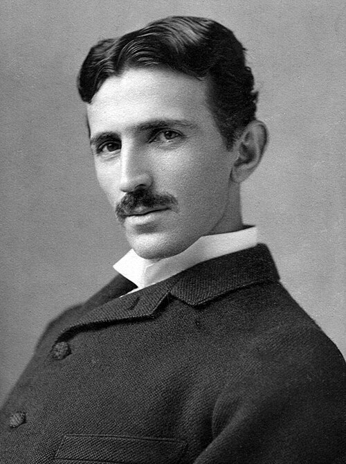

# Nikola Tesla

**Born:** 10 July 1856

**Died / status:** 7 January 1943

**Fields:** Electromagnetism, Electrical technology, High-frequency physics

For the date, creator, form and attribution of this image, see its source record.

## Biography

Tesla was a Serbian-American inventor and electrical engineer who moved from European electrical work to research in the United States. His rotating-field motors, polyphase systems and high-frequency experiments strongly influenced electrical engineering and applied physics.

## Major contributions to physics

- Developed polyphase alternating-current systems and induction motors
- Built Tesla coils and investigated high-frequency, high-voltage discharges
- Studied wireless energy transfer and applications of high-frequency currents

## Historical and source notes

- His principal roles were inventor and engineer.
- Radio and alternating-current systems developed through the work of multiple scientists and engineers.

## Image source and rights

- Source: [Original image record](https://commons.wikimedia.org/wiki/File:Tesla_circa_1890.jpeg)
- Creator / attribution: Napoleon Sarony (1821–1896)
- License or rights statement: [Public domain](https://commons.wikimedia.org/wiki/File:Tesla_circa_1890.jpeg)
- Local image: [16c47f535cd231bd9d24.jpeg](../portraits/16c47f535cd231bd9d24.jpeg)
- Credit: postcard Tesla Museum, document no. MNT, VI/V 10, via RadioGraphics

## Sources

- [Nikola Tesla — Wikipedia — dates and biographical overview](https://en.wikipedia.org/wiki/Nikola_Tesla)

Record reviewed: 2026-10-26.
