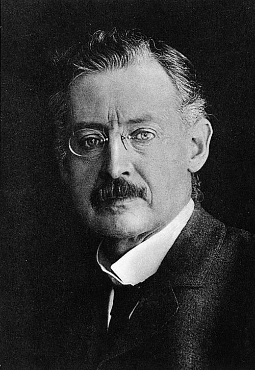

# Carl Runge

**Born:** 30 August 1856

**Died / status:** 3 January 1927

**Fields:** Numerical methods, Spectroscopy, Mathematical physics

For the image’s date, creator, form and attribution, see its source record.

## Biography

Runge was a German mathematician and physicist who worked in Hanover and Göttingen. He developed numerical techniques for differential equations while studying atomic spectra with experimental collaborators including Paschen, connecting practical computation with precision spectroscopy.

## Major contributions to physics

- Developed numerical integration methods associated with Runge and Kutta
- Investigated spectral series and precision atomic spectra
- Advanced interpolation, approximation and applied mathematical methods for physics

## Image source and rights

- Source: [Original image record](https://commons.wikimedia.org/wiki/File:Voit_202_Karl_Runge.jpg)
- Creator / attribution: Peter Matzen (1878–1930)
- License or rights statement: [Public domain](https://commons.wikimedia.org/wiki/File:Voit_202_Karl_Runge.jpg)
- Local image: [a8664ef1f3ddc6c86d47-ea3f324139.jpg](../portraits/a8664ef1f3ddc6c86d47-ea3f324139.jpg)
- Credit: Voit Collection

## Sources

- [Carl Runge — MacTutor, University of St Andrews](https://mathshistory.st-andrews.ac.uk/Biographies/Runge/)
- [Carl Runge — Wikipedia biography](https://en.wikipedia.org/wiki/Carl_Runge)

Record reviewed: 2026-10-26.
