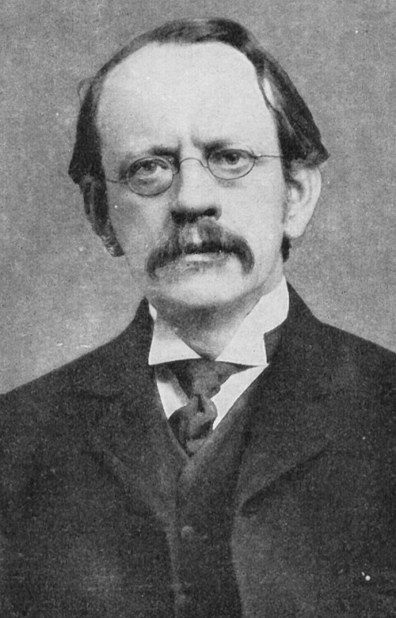

# Joseph John Thomson

**Born:** 18 December 1856

**Died / status:** 30 August 1940

**Fields:** Atomic physics, Electron physics

For the photographer or artist, date and type of image, consult the original image record.

## Biography

Joseph John Thomson was born in Cheetham Hill, United Kingdom and conducted research in atomic physics and electron physics. Nobel records list University of Cambridge as the affiliation at the time of the award. They studied cathode rays and gas discharges, establishing experimental evidence for the electron. They were awarded the Nobel Prize in Physics in 1906.

## Major contributions to physics

- Studied cathode rays and gas discharges, establishing experimental evidence for the electron
- Measured the charge-to-mass ratio of cathode-ray particles

**Nobel Prize in Physics:** 1906

## Image source and rights

- Source: [Original image record](https://commons.wikimedia.org/wiki/File:J.J_Thomson.jpg)
- Creator / attribution: Not Mentioned
- License or rights statement: Public domain
- Local image: [bcb6405f70a8a9c32259.jpg](../portraits/bcb6405f70a8a9c32259.jpg)
- Credit: First World War.com

## Sources

- [J.J. Thomson - Facts](https://www.nobelprize.org/prizes/physics/1906/thomson/facts/)
- [Nobel Prize official laureate API, id 10](https://api.nobelprize.org/2.1/laureate/10)
- [Wikipedia: J. J. Thomson](https://en.wikipedia.org/wiki/J._J._Thomson)

Record reviewed: 2026-10-26.
