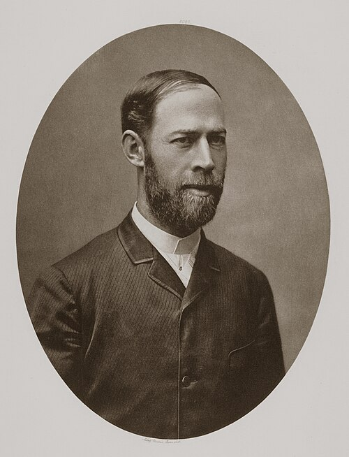

# Heinrich Hertz

**Born:** 22 February 1857

**Died / status:** 1 January 1894

**Fields:** Electromagnetism, Photoelectric effects, Contact mechanics

For the date, creator, form and attribution of this image, see its source record.

## Biography

Hertz was a German experimental physicist trained under Helmholtz in Berlin who later taught in Karlsruhe and Bonn. His spark oscillators and receivers generated and detected electromagnetic waves, decisively testing Maxwell's theory. He also investigated contact mechanics and electrical discharges.

## Major contributions to physics

- Generated electromagnetic waves and demonstrated their reflection, refraction, interference and polarization
- Observed ultraviolet enhancement of spark discharge, an early clue to the photoelectric effect
- Established Hertzian elastic-contact theory

## Image source and rights

- Source: [Original image record](https://commons.wikimedia.org/wiki/File:HEINRICH_HERTZ.JPG)
- Creator / attribution: Robert Krewaldt, Kaiserplatz 16, Bonn
- License or rights statement: [Public domain](https://commons.wikimedia.org/wiki/File:HEINRICH_HERTZ.JPG)
- Local image: [924c5a0856501ef61036.jpg](../portraits/924c5a0856501ef61036.jpg)
- Credit: Cabinetphotograph, Kabinettfotografie

## Sources

- [Heinrich Hertz — MacTutor, University of St Andrews](https://mathshistory.st-andrews.ac.uk/Biographies/Hertz_Heinrich/)
- [Heinrich Hertz — Wikipedia — dates and biographical overview](https://en.wikipedia.org/wiki/Heinrich_Hertz)

Record reviewed: 2026-10-26.
