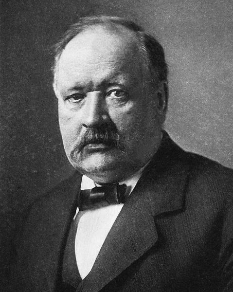

# Svante Arrhenius

**Born:** 19 February 1859

**Died / status:** 2 October 1927

**Fields:** Physical chemistry, Electrochemistry, Climate physics

For the image’s date, creator, form and attribution, see its source record.

## Biography

Arrhenius was a Swedish physical chemist and physicist who studied in Uppsala and elsewhere in Europe and later directed Stockholm's Nobel physical-chemistry institute. Awarded the 1903 Nobel Prize in Chemistry, he connected ionic theory, solutions and electricity and investigated atmospheric radiation.

## Major contributions to physics

- Developed the electrolytic dissociation theory of charged ions in solution
- Formulated the temperature dependence of reaction rates associated with his name
- Made early quantitative calculations of the climatic effects of changing carbon dioxide

## Image source and rights

- Source: [Original image record](https://commons.wikimedia.org/wiki/File:Arrhenius2.jpg)
- Creator / attribution: Photogravure Meisenbach Riffarth & Co. Leipzig.
- License or rights statement: [Public domain](https://commons.wikimedia.org/wiki/File:Arrhenius2.jpg)
- Local image: [c0c060a7dc72200ce82d-e86d4032dc.jpg](../portraits/c0c060a7dc72200ce82d-e86d4032dc.jpg)
- Credit: Zeitschrift für Physikalische Chemie, Band 69, 1909.

## Sources

- [Svante Arrhenius — Nobel Prize official facts](https://www.nobelprize.org/prizes/chemistry/1903/arrhenius/facts/)
- [Svante Arrhenius — Wikipedia biography](https://en.wikipedia.org/wiki/Svante_Arrhenius)

Record reviewed: 2026-10-26.
