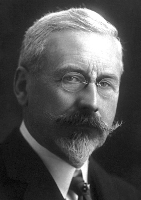

# Charles Edouard Guillaume

**Born:** 15 February 1861

**Died / status:** 13 June 1938

**Fields:** Precision measurement, Materials physics

For the photographer or artist, date and type of image, consult the original image record.

## Biography

Charles Edouard Guillaume was born in Fleurier, Switzerland and conducted research in precision measurement and materials physics. Nobel records list Bureau International des Poids et Mesures (International Bureau of Weights and Measures) as the affiliation at the time of the award. They discovered and studied low-expansion iron-nickel alloys, including Invar. They were awarded the Nobel Prize in Physics in 1920.

## Major contributions to physics

- Discovered and studied low-expansion iron-nickel alloys, including Invar
- Improved length standards and instruments affected by temperature changes

**Nobel Prize in Physics:** 1920

## Image source and rights

- Source: [Original image record](https://commons.wikimedia.org/wiki/File:Guillaume_1920.jpg)
- Creator / attribution: A. B. Lagrelius & Westphal, Stockholm. The American Institute of Physics also credits this photo [1] to AB Lagrelius & Westphal, which is the Swedish company used by the Nobel Foundation for most photos of its book series Les Prix Nobel.
- License or rights statement: Public domain
- Local image: [7a2d7671de37538d3dc5.jpg](../portraits/7a2d7671de37538d3dc5.jpg)
- Credit: http://nobelprize.org/nobel_prizes/physics/laureates/1920/guillaume-bio.html

## Sources

- [Charles Edouard Guillaume - Facts](https://www.nobelprize.org/prizes/physics/1920/guillaume/facts/)
- [Nobel Prize official laureate API, id 25](https://api.nobelprize.org/2.1/laureate/25)
- [Wikipedia: Charles Édouard Guillaume](https://en.wikipedia.org/wiki/Charles_%C3%89douard_Guillaume)

Record reviewed: 2026-10-26.
