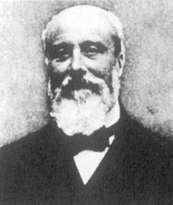

# Pierre Duhem

**Born:** 10 June 1861 (date disputed)

**Died / status:** 14 September 1916

**Fields:** Thermodynamics, Physical chemistry, Foundations of physics

For the date, creator, form and attribution of this image, see its source record.

## Biography

Duhem was a French theoretical physicist, historian and philosopher of science who worked mainly at Bordeaux. He pursued thermodynamics as a framework for physics, investigated chemical equilibrium, fluids and elasticity, and wrote influential studies of scientific theories and their testing.

## Major contributions to physics

- Developed chemical thermodynamics, thermodynamic potentials and equilibrium theory
- Contributed to the Gibbs–Duhem relation constraining changes in chemical potentials
- Studied continuum physics and the logical structure of physical theories

## Historical and source notes

- Sources disagree between 9 and 10 June. This archive adopts 10 June from Picard’s 1921 memorial published by the Académie des sciences and the Royal Academy of Belgium; the University of Bordeaux collection description and some English sources give 9 June. The disagreement is retained.

## Image source and rights

- Source: [Original image record](https://commons.wikimedia.org/wiki/File:Pierre_Duhem.jpg)
- Creator / attribution: Unknown author Uploaded by Palthrow at en.wikipedia
- License or rights statement: Public domain
- Local image: [8c2a4c3f03553c41b232.jpg](../portraits/8c2a4c3f03553c41b232.jpg)
- Credit: http://carnap.umd.edu/~parkerdn/250/Duhem.jpg Transferred from en.wikipedia to Commons by User:Magnus Manske using CommonsHelper.

## Sources

- [Pierre Duhem — Royal Academy of Belgium](https://academieroyale.be/fr/who-who-detail/relations/pierre-maurice-marie-duhem)
- [Pierre Duhem — MacTutor, University of St Andrews](https://mathshistory.st-andrews.ac.uk/Biographies/Duhem/)
- [Pierre Duhem — Wikipedia — dates and biographical overview](https://en.wikipedia.org/wiki/Pierre_Duhem)
- [Émile Picard: La vie et l’œuvre de Pierre Duhem — Académie des sciences (1921)](https://www.academie-sciences.fr/pdf/dossiers/Picard/Picard_pdf/Picard_Duhem.pdf)
- [Pierre Duhem collection — University of Bordeaux Libraries](https://bibliotheques.u-bordeaux.fr/Les-bibliotheques/Patrimoine-documentaire/Fonds-documentaires-patrimoniaux/Fonds-scientifique)

Record reviewed: 2026-10-26.
