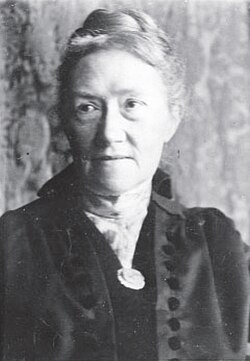

# Agnes Pockels

**Born:** 14 February 1862

**Died / status:** 21 November 1935

**Fields:** Surface physics, Interface science, Experimental methods

For the date, creator, form and attribution of this image, see its source record.

## Biography

Pockels was a largely self-taught experimental researcher born in Venice and living in Germany. Denied a conventional university education, she studied contaminated water surfaces at home. A letter to Rayleigh led to publication of work that became important to surface and monolayer physics.

## Major contributions to physics

- Designed a surface trough with controllable area for quantitative surface-tension measurements
- Measured the effects of small quantities of oil and impurities on water surfaces
- Provided experimental foundations for later monolayer and Langmuir-film studies

## Image source and rights

- Source: [Original image record](https://commons.wikimedia.org/wiki/File:Agnes_Pockels_ca1922.jpg)
- Creator / attribution: Unknown author
- License or rights statement: Public domain
- Local image: [89b618cae13eed30f194.jpg](../portraits/89b618cae13eed30f194.jpg)
- Credit: https://www.tu-braunschweig.de/Medien-DB/agnespockelslab/download/chemkon_agnes_pockels.pdf

## Sources

- [Agnes Pockels — Wikipedia — dates and biographical overview](https://en.wikipedia.org/wiki/Agnes_Pockels)

Record reviewed: 2026-10-26.
