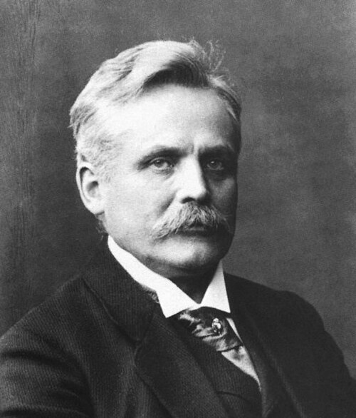

# Wilhelm Wien

**Born:** 13 January 1864

**Died / status:** 30 August 1928

**Fields:** Thermal radiation, Thermodynamics

For the photographer or artist, date and type of image, consult the original image record.

## Biography

Wilhelm Wien was born in Gaffken, Prussia (now Parusnoye, Russia) and conducted research in thermal radiation and thermodynamics. Nobel records list Würzburg University as the affiliation at the time of the award. They established Wien's displacement law for black-body radiation. They were awarded the Nobel Prize in Physics in 1911.

## Major contributions to physics

- Established Wien's displacement law for black-body radiation
- Investigated the relation between temperature and the distribution of thermal radiation

**Nobel Prize in Physics:** 1911

## Image source and rights

- Source: [Original image record](https://commons.wikimedia.org/wiki/File:Wien2.jpg)
- Creator / attribution: See the original image record
- License or rights statement: Public domain
- Local image: [a125dcd5234ad29cbe1e.jpg](../portraits/a125dcd5234ad29cbe1e.jpg)

## Sources

- [Wilhelm Wien - Facts](https://www.nobelprize.org/prizes/physics/1911/wien/facts/)
- [Nobel Prize official laureate API, id 16](https://api.nobelprize.org/2.1/laureate/16)
- [Wikipedia: Wilhelm Wien](https://en.wikipedia.org/wiki/Wilhelm_Wien)

Record reviewed: 2026-10-26.
