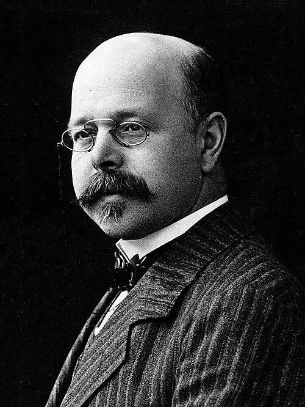

# Walther Nernst

**Born:** 25 June 1864

**Died / status:** 18 November 1941

**Fields:** Thermodynamics, Low-temperature physics, Electrochemistry

For the date, creator, form and attribution of this image, see its source record.

## Biography

Nernst was a German physical chemist and physicist who worked in Göttingen and Berlin and received the 1920 Nobel Prize in Chemistry. He applied thermodynamics to reactions and low-temperature processes while also investigating electrochemistry, materials and instruments.

## Major contributions to physics

- Proposed the heat theorem that helped establish the third law of thermodynamics
- Formulated the relation between electrode potential and concentration
- Studied low-temperature heat capacities, chemical equilibrium and thermomagnetic transport

## Image source and rights

- Source: [Original image record](https://commons.wikimedia.org/wiki/File:Walther_Nernst_1900s.jpg)
- Creator / attribution: Unknown (Mondadori Publishers)
- License or rights statement: Public domain
- Local image: [b5ddcb76cc7860739883.jpg](../portraits/b5ddcb76cc7860739883.jpg)
- Credit: http://www.gettyimages.co.uk/detail/news-photo/portrait-of-the-german-chemist-and-physicist-walter-hermann-news-photo/141553142

## Sources

- [Walther Nernst — Wikipedia — dates and biographical overview](https://en.wikipedia.org/wiki/Walther_Nernst)
- [Walther Nernst — Nobel Prize official biography](https://www.nobelprize.org/prizes/chemistry/1920/nernst/biographical/)

Record reviewed: 2026-10-26.
