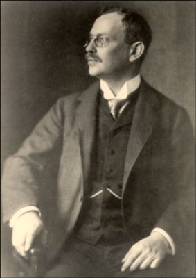

# Heinrich Rubens

**Born:** 30 March 1865

**Died / status:** 17 July 1922

**Fields:** Infrared physics, Thermal radiation, Precision measurement

For the image’s date, creator, form and attribution, see its source record.

## Biography

Rubens was a German experimental physicist trained under Kundt and active in Berlin. He extended precision infrared measurements to longer wavelengths. Data obtained with Kurlbaum helped guide Planck toward his radiation law, making Rubens an important experimental contributor to early quantum theory.

## Major contributions to physics

- Developed far-infrared spectroscopy and selective-reflection techniques
- Measured long-wavelength black-body radiation with Kurlbaum
- Investigated metallic optics and relations between radiation and electrical conductivity

## Image source and rights

- Source: [Original image record](https://www.sammlungen.hu-berlin.de/objekte/portraetsammlung-berliner-hochschullehrer/13206/)
- Creator / attribution: See the original image record
- License or rights statement: Copyrighted or republication permission unverified; consult the original record
- Local image: [5fa0c38c10991bc4565d-4998a7aac2.png](../portraits/5fa0c38c10991bc4565d-4998a7aac2.png)
- Credit: Humboldt-Universität zu Berlin, Universitätsbibliothek, portrait collection, item13206
- Republication: permission for use on a public website has not been verified. Confirm permission with the rightsholder or replace the image before publication.

## Sources

- [Heinrich Rubens — Neue Deutsche Biographie](https://www.deutsche-biographie.de/info_116669187.html)
- [Heinrich Rubens — Wikipedia biography](https://en.wikipedia.org/wiki/Heinrich_Rubens)

Record reviewed: 2026-10-26.
