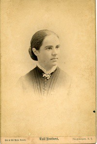

# Antonia Maury

**Born:** 21 March 1866

**Died / status:** 8 January 1952

**Fields:** Stellar physics, Spectroscopy, Observational astronomy

For the date, creator, form and attribution of this image, see its source record.

## Biography

Maury was an American astronomer from a scientific family who studied stellar spectra at Harvard College Observatory. Her detailed classification emphasized line widths and shapes rather than only the usual sequence, supplying evidence important to understanding stellar luminosities and evolutionary states.

## Major contributions to physics

- Devised a spectral classification incorporating line width and morphology
- Provided classifications that helped Hertzsprung distinguish giant and dwarf stars
- Investigated spectroscopic binaries and changes in stellar spectra

## Image source and rights

- Source: [Original image record](https://vcencyclopedia.vassar.edu/distinguished-alumni/antonia-maury/)
- Creator / attribution: Vassar College; Photographer not identified
- License or rights statement: Public domain (circa 1887 photograph; same portrait source as Commons Antonia maury.jpg)
- Local image: [717eecc52bf67204fd93-6623382a84.jpeg](../portraits/717eecc52bf67204fd93-6623382a84.jpeg)
- Credit: Vassar College senior-year portrait, circa 1887; courtesy Vassar College Encyclopedia.

## Sources

- [Antonia Maury — Wikipedia — dates and biographical overview](https://en.wikipedia.org/wiki/Antonia_Maury)

Record reviewed: 2026-10-26.
