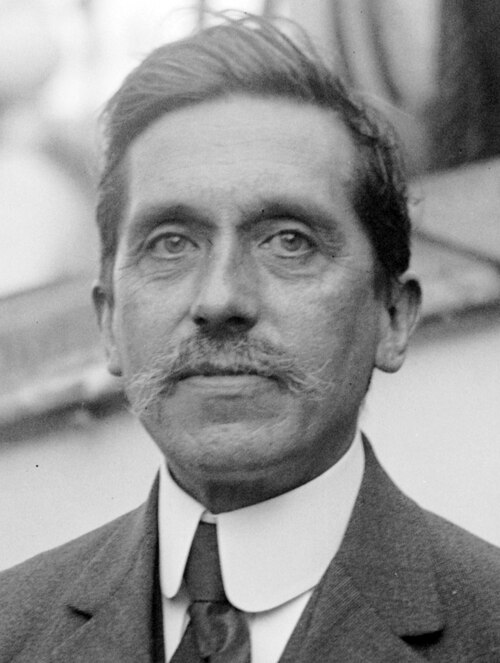

# Charles Fabry

**Born:** 11 June 1867

**Died / status:** 11 December 1945

**Fields:** Optics, Interferometric metrology, Spectroscopy

For the date, creator, form and attribution of this image, see its source record.

## Biography

Fabry was a French physicist who taught in Marseille and later developed optical research and education in Paris. With Alfred Perot he created a high-resolution interferometer, applying precision interference to spectral structure, wavelength standards and atmospheric absorption.

## Major contributions to physics

- Invented the Fabry–Perot interferometer with Perot
- Used interference to study fine spectral structure and wavelength standards
- Investigated atmospheric ozone absorption with Henri Buisson

## Image source and rights

- Source: [Original image record](https://commons.wikimedia.org/wiki/File:Charles_Fabry.jpg)
- Creator / attribution: George Grantham Bain Collection (Library of Congress)
- License or rights statement: Public domain
- Local image: [ebf1b44c77cbe330bb69.jpg](../portraits/ebf1b44c77cbe330bb69.jpg)
- Credit: This image is available from the United States Library of Congress's Prints and Photographs division under the digital ID ggbain.37539.This tag does not indicate the copyright status of the attached work. A normal copyright tag is still required. See Commons:Licensing.

## Sources

- [Charles Fabry — Wikipedia — dates and biographical overview](https://en.wikipedia.org/wiki/Charles_Fabry)

Record reviewed: 2026-10-26.
