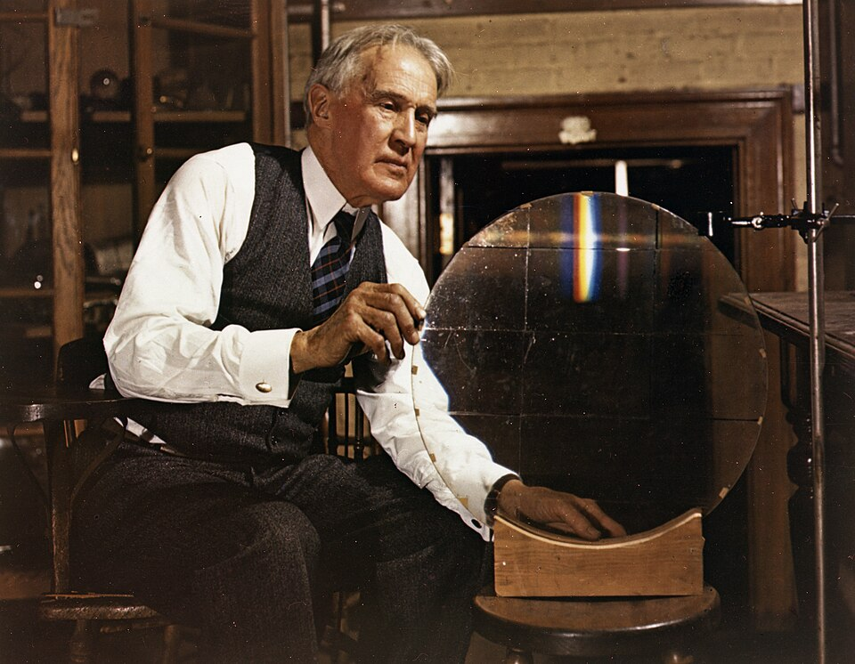

# Robert W. Wood

**Born:** 2 May 1868

**Died / status:** 11 August 1955

**Fields:** Optics, Spectroscopy, Experimental methods

For the date, creator, form and attribution of this image, see its source record.

## Biography

Wood was an American experimental physicist at Johns Hopkins known for inventive optical experiments, photography and demonstrations. He studied ultraviolet and infrared radiation, resonance and grating effects, and used experimental investigation to expose the unsupported claim of N-rays.

## Major contributions to physics

- Investigated diffraction-grating anomalies now associated with his name
- Advanced ultraviolet and infrared photography and selective optical filters
- Studied resonance radiation, fluorescence and ultrasonic experiments

## Image source and rights

- Source: [Original image record](https://commons.wikimedia.org/wiki/File:Robert_Williams_Wood.jpg)
- Creator / attribution: AIP Emilio Segrè Visual Archives, Gift of David L. MacAdam
- License or rights statement: Attribution
- Local image: [e2dee5dc68a826e4c414.jpg](../portraits/e2dee5dc68a826e4c414.jpg)
- Credit: https://repository.aip.org/robert-williams-wood-his-mosaic-replica-diffraction-grating-johns-hopkins-university

## Sources

- [Robert W. Wood — Wikipedia — dates and biographical overview](https://en.wikipedia.org/wiki/Robert_W._Wood)

Record reviewed: 2026-10-26.
