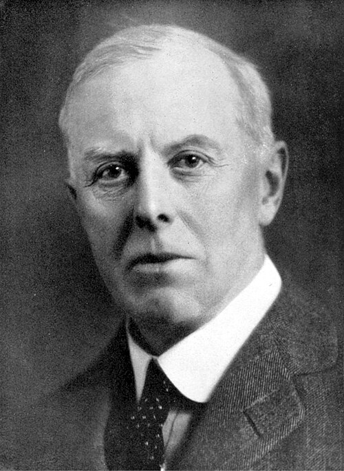

# John Sealy Townsend

**Born:** 7 June 1868

**Died / status:** 16 February 1957

**Fields:** Gas discharges, Plasma physics, Electronic transport

For the image’s date, creator, form and attribution, see its source record.

## Biography

Townsend was an Irish-born experimental physicist who investigated gas ionization at Cambridge before becoming a professor at Oxford. His quantitative work on electrons and ions established important foundations for gas-discharge and plasma physics.

## Major contributions to physics

- Developed quantitative descriptions of impact ionization and electron avalanches, including Townsend discharge coefficients
- Measured transport properties of ions and electrons in gases
- Investigated low-energy electron scattering associated with the Ramsauer–Townsend effect

## Image source and rights

- Source: [Original image record](https://commons.wikimedia.org/wiki/File:John_Sealy_Townsend.jpg)
- Creator / attribution: The original uploader was QueenAdelaide at English Wikipedia.
- License or rights statement: [GFDL](https://en.wikipedia.org/wiki/en:Creative_Commons)
- Local image: [f7c9b00831a172721ace-ed27f58cc8.jpg](../portraits/f7c9b00831a172721ace-ed27f58cc8.jpg)
- Credit: "John Sealy Edward Townsend. 1868-1957". Biographical Memoirs of Fellows of the Royal Society, Vol. 3 (Nov., 1957), p. 257

## Sources

- [John Sealy Townsend — Royal Society archive](https://catalogues.royalsociety.org/CalmView/Record.aspx?src=CalmView.Persons&id=NA2902&pos=3)
- [John Sealy Townsend — Wikipedia biography](https://en.wikipedia.org/wiki/John_Sealy_Townsend)

Record reviewed: 2026-10-26.
