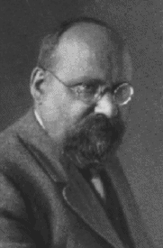

# Gustav Mie

**Born:** 29 September 1868

**Died / status:** 13 February 1957

**Fields:** Electromagnetism, Light scattering, Theoretical physics

For the image’s date, creator, form and attribution, see its source record.

## Biography

Mie was a German theoretical physicist who taught in Greifswald, Halle and Freiburg. His work on electromagnetic fields and matter included a rigorous calculation of scattering by spheres, influential in optics and particle characterization, as well as attempts at field-based models of matter.

## Major contributions to physics

- Developed a complete electromagnetic scattering solution for homogeneous spheres
- Explained scattering and colour effects in colloidal particle systems
- Investigated electromagnetic field theory and field models of matter

## Image source and rights

- Source: [Original image record](https://www.ugr.es/~aquiran/mie.htm)
- Creator / attribution: See the original image record
- License or rights statement: Copyrighted or republication permission unverified; consult the original record
- Local image: [84767c90542d195708fb-d1e6521ce2.gif](../portraits/84767c90542d195708fb-d1e6521ce2.gif)
- Credit: Arturo Quirantes, University of Granada, Mie Translation Project
- Republication: permission for use on a public website has not been verified. Confirm permission with the rightsholder or replace the image before publication.

## Sources

- [Gustav Mie — Neue Deutsche Biographie](https://www.deutsche-biographie.de/pnd118733826.html)
- [Gustav Mie — Wikipedia biography](https://en.wikipedia.org/wiki/Gustav_Mie)

Record reviewed: 2026-10-26.
