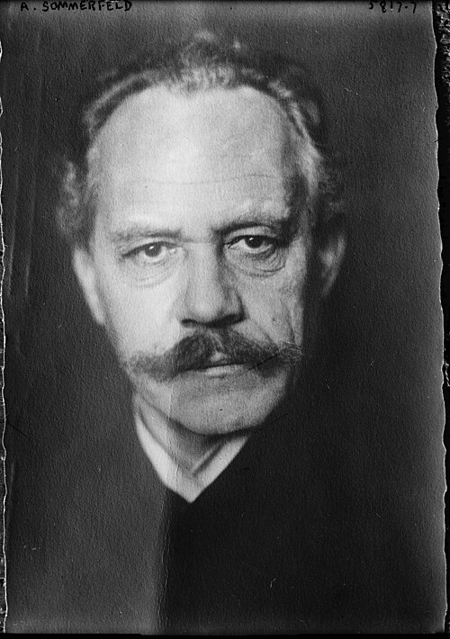

# Arnold Sommerfeld

**Born:** 5 December 1868

**Died / status:** 26 April 1951

**Fields:** Quantum physics, Atomic physics, Condensed-matter physics

For the date, creator, form and attribution of this image, see its source record.

## Biography

Sommerfeld was a German theoretical physicist whose Munich research school trained Heisenberg, Pauli and many other leading scientists. His work bridged classical electrodynamics and early quantum theory, using powerful mathematical methods to solve concrete physical problems.

## Major contributions to physics

- Extended Bohr's model to elliptical orbits and relativistic spectral corrections
- Developed a quantum-statistical free-electron theory of metals
- Investigated diffraction and electromagnetic propagation and established an influential research school

## Image source and rights

- Source: [Original image record](https://commons.wikimedia.org/wiki/File:A._Sommerfeld_LCCN2014715010.jpg)
- Creator / attribution: Bain News Service, publisher
- License or rights statement: Public domain
- Local image: [fdd08850d11f4b02136c.jpg](../portraits/fdd08850d11f4b02136c.jpg)
- Credit: Library of Congress Catalog: https://lccn.loc.gov/2014715010 Image download: https://cdn.loc.gov/service/pnp/ggbain/34800/34858v.jpg Original url: https://www.loc.gov/pictures/item/2014715010/

## Sources

- [Arnold Sommerfeld — MacTutor, University of St Andrews](https://mathshistory.st-andrews.ac.uk/Biographies/Sommerfeld/)
- [Arnold Sommerfeld — Wikipedia — dates and biographical overview](https://en.wikipedia.org/wiki/Arnold_Sommerfeld)

Record reviewed: 2026-10-26.
