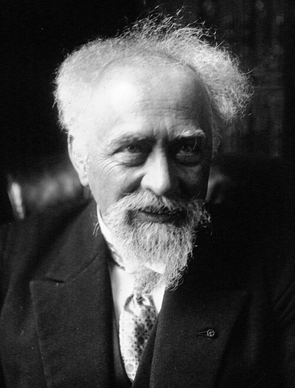

# Jean Baptiste Perrin

**Born:** 30 September 1870

**Died / status:** 17 April 1942

**Fields:** Statistical physics, Atomic theory

For the photographer or artist, date and type of image, consult the original image record.

## Biography

Jean Baptiste Perrin was born in Lille, France and conducted research in statistical physics and atomic theory. Nobel records list Sorbonne University as the affiliation at the time of the award. They studied Brownian motion experimentally and determined Avogadro's constant. They were awarded the Nobel Prize in Physics in 1926.

## Major contributions to physics

- Studied Brownian motion experimentally and determined Avogadro's constant
- Provided strong evidence for the physical existence of atoms and molecules

**Nobel Prize in Physics:** 1926

## Image source and rights

- Source: [Original image record](https://commons.wikimedia.org/wiki/File:Jean_Perrin_1926.jpg)
- Creator / attribution: Agence de presse Meurisse
- License or rights statement: Public domain
- Local image: [51567385c989b71e5a02.jpg](../portraits/51567385c989b71e5a02.jpg)
- Credit: Bibliothèque nationale de France

## Sources

- [Jean Baptiste Perrin - Facts](https://www.nobelprize.org/prizes/physics/1926/perrin/facts/)
- [Nobel Prize official laureate API, id 32](https://api.nobelprize.org/2.1/laureate/32)
- [Wikipedia: Jean Baptiste Perrin](https://en.wikipedia.org/wiki/Jean_Baptiste_Perrin)

Record reviewed: 2026-10-26.
