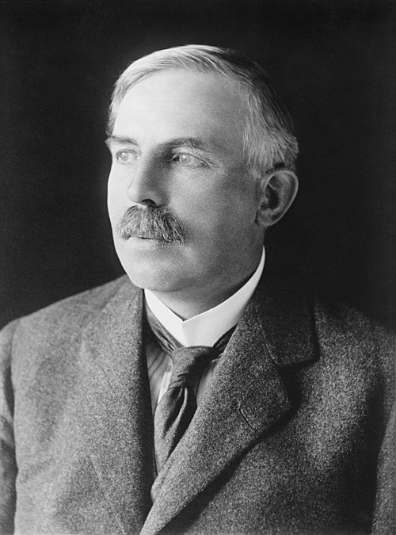

# Ernest Rutherford

**Born:** 30 August 1871

**Died / status:** 19 October 1937

**Fields:** Nuclear physics, Radioactivity, Atomic structure

For the date, creator, form and attribution of this image, see its source record.

## Biography

Rutherford was a New Zealand-born experimental physicist who worked at McGill, Manchester and Cambridge and received the 1908 Nobel Prize in Chemistry. Beginning with radioactivity, he moved into atomic structure and nuclear reactions, establishing central foundations of nuclear physics.

## Major contributions to physics

- Distinguished alpha and beta radiation and developed radioactive-decay theory with Soddy
- Proposed the nuclear atom on the basis of Geiger–Marsden scattering experiments
- Produced artificial nuclear transmutation with alpha particles and identified the role of hydrogen nuclei

## Image source and rights

- Source: [Original image record](https://commons.wikimedia.org/wiki/File:Sir_Ernest_Rutherford_LCCN2014716719_-_restoration1.jpg)
- Creator / attribution: Bain News Service, publisher Restored by: Bammesk
- License or rights statement: [Public domain](https://commons.wikimedia.org/wiki/File:Sir_Ernest_Rutherford_LCCN2014716719_-_restoration1.jpg)
- Local image: [af68f9b6b83ec704a97e.jpg](../portraits/af68f9b6b83ec704a97e.jpg)
- Credit: Library of Congress Catalog: https://lccn.loc.gov/2014716719 Image download: https://cdn.loc.gov/service/pnp/ggbain/36500/36570v.jpg Original url: https://www.loc.gov/pictures/item/2014716719/

## Sources

- [Ernest Rutherford — NobelPrize.org biography](https://www.nobelprize.org/prizes/chemistry/1908/rutherford/biographical/)
- [Ernest Rutherford — Wikipedia — dates and biographical overview](https://en.wikipedia.org/wiki/Ernest_Rutherford)

Record reviewed: 2026-10-26.
