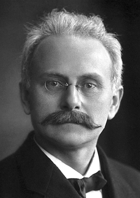

# Johannes Stark

**Born:** 15 April 1874

**Died / status:** 21 June 1957

**Fields:** Atomic physics, Spectroscopy

For the photographer or artist, date and type of image, consult the original image record.

## Biography

Johannes Stark was born in Schickenhof, Germany and conducted research in atomic physics and spectroscopy. Nobel records list Greifswald University as the affiliation at the time of the award. They discovered the splitting of spectral lines in an electric field, the Stark effect. They were awarded the Nobel Prize in Physics in 1919.

## Major contributions to physics

- Discovered the splitting of spectral lines in an electric field, the Stark effect
- Investigated positive-ion rays and atomic spectra

**Nobel Prize in Physics:** 1919

## Image source and rights

- Source: [Original image record](https://commons.wikimedia.org/wiki/File:Johannes_Stark.jpg)
- Creator / attribution: A. B. Lagrelius & Westphal, Stockholm
- License or rights statement: Public domain
- Local image: [f195897c7334080062d1.jpg](../portraits/f195897c7334080062d1.jpg)
- Credit: Published in 1920 in Sweden in Les Prix Nobel 1919 (p. 121) with a credit to A. B. Lagrelius & Westphal, Stockholm, web version. Also Britannica. The American Institute of Physics credits the photo [1] to AB Lagrelius & Westphal (Swedish company used by the Nobel Foundation for most photos of its book series Les Prix Nobel).

## Sources

- [Johannes Stark - Facts](https://www.nobelprize.org/prizes/physics/1919/stark/facts/)
- [Nobel Prize official laureate API, id 24](https://api.nobelprize.org/2.1/laureate/24)
- [Wikipedia: Johannes Stark](https://en.wikipedia.org/wiki/Johannes_Stark)

Record reviewed: 2026-10-26.
