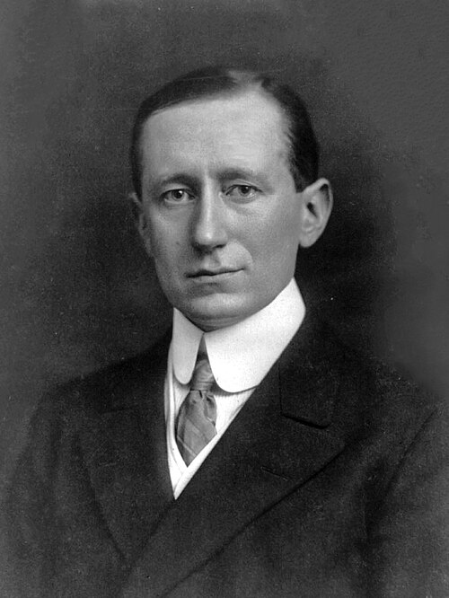

# Guglielmo Marconi

**Born:** 25 April 1874

**Died / status:** 20 July 1937

**Fields:** Electromagnetism, Wireless communication

For the photographer or artist, date and type of image, consult the original image record.

## Biography

Guglielmo Marconi was born in Bologna, Italy and conducted research in electromagnetism and wireless communication. Nobel records list Marconi Wireless Telegraph Co. Ltd. as the affiliation at the time of the award. They developed long-distance wireless telegraphy and advanced transatlantic radio-transmission experiments. They were awarded the Nobel Prize in Physics in 1909.

## Major contributions to physics

- Developed long-distance wireless telegraphy and advanced transatlantic radio-transmission experiments
- Helped turn electromagnetic-wave communication into a practical engineering system

**Nobel Prize in Physics:** 1909

## Image source and rights

- Source: [Original image record](https://commons.wikimedia.org/wiki/File:Guglielmo_Marconi.jpg)
- Creator / attribution: Pach Brothers
- License or rights statement: Public domain
- Local image: [6268ddf7c433bf61a58e.jpg](../portraits/6268ddf7c433bf61a58e.jpg)
- Credit: This image is available from the United States Library of Congress's Prints and Photographs division under the digital ID cph.3a40043.This tag does not indicate the copyright status of the attached work. A normal copyright tag is still required. See Commons:Licensing.

## Sources

- [Guglielmo Marconi - Facts](https://www.nobelprize.org/prizes/physics/1909/marconi/facts/)
- [Nobel Prize official laureate API, id 13](https://api.nobelprize.org/2.1/laureate/13)
- [Wikipedia: Guglielmo Marconi](https://en.wikipedia.org/wiki/Guglielmo_Marconi)

Record reviewed: 2026-10-26.
