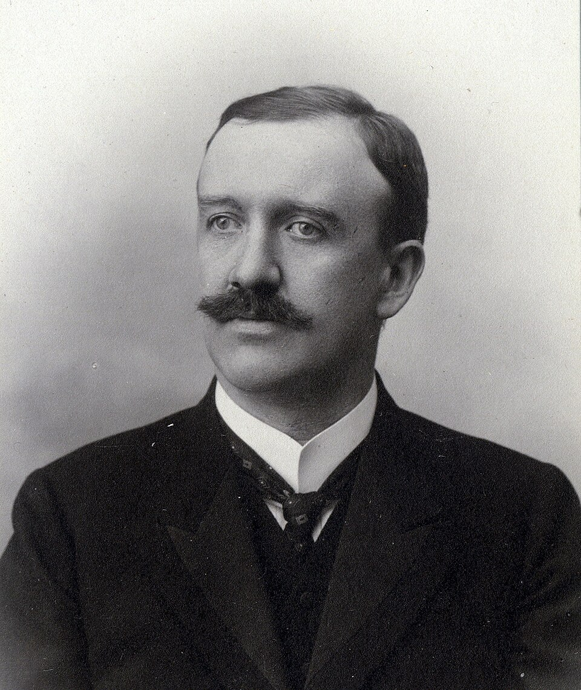

# Friedrich Hasenöhrl

**Born:** 30 November 1874

**Died / status:** 7 October 1915

**Fields:** Thermal radiation, Kinetic theory of gases, Theoretical physics

For the image’s date, creator, form and attribution, see its source record.

## Biography

Hasenöhrl was an Austrian theoretical physicist trained in Vienna under figures including Boltzmann. He later held a Vienna professorship and investigated kinetic theory, radiation and electromagnetic inertia. He was killed during the First World War.

## Major contributions to physics

- Investigated the contribution of cavity radiation to inertia
- Studied kinetic theory and the thermodynamics of radiation
- Contributed to theoretical physics research and education during the transition to relativity and quantum theory

## Historical and source notes

- His calculation of cavity-radiation inertia differs from the universal mass–energy relation of special relativity; it is not presented as establishing E=mc² before Einstein.

## Image source and rights

- Source: [Original image record](https://commons.wikimedia.org/wiki/File:Hasenoehrl.jpg)
- Creator / attribution: See the original image record
- License or rights statement: [Public domain](https://commons.wikimedia.org/wiki/File:Hasenoehrl.jpg)
- Local image: [456fe01427a34c72eaa8-f2f3d3348b.jpg](../portraits/456fe01427a34c72eaa8-f2f3d3348b.jpg)
- Credit: http://www.univie.ac.at/archiv/tour/17.htm

## Sources

- [Friedrich Hasenöhrl — University of Vienna Library](https://bibliothek.univie.ac.at/zb-physik-fb-chemie/friedrich_hasenohrl.html)
- [Friedrich Hasenöhrl — Wikipedia biography](https://en.wikipedia.org/wiki/Friedrich_Hasen%C3%B6hrl)

Record reviewed: 2026-10-26.
