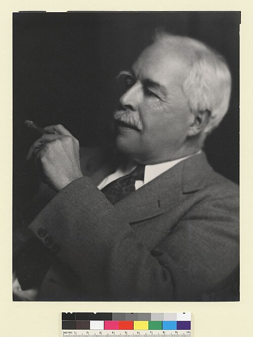

# Gilbert N. Lewis

**Born:** 23 October 1875 (date disputed)

**Died / status:** 23 March 1946

**Fields:** Thermodynamics, Physical chemistry, Atomic and molecular physics

For the date, creator, form and attribution of this image, see its source record.

## Biography

Lewis was an American physical chemist who built a major research programme at Berkeley. His work connected thermodynamic methods with real chemical systems and ranged across free energy, electrochemistry, bonding, isotopes and the early terminology of light quanta.

## Major contributions to physics

- Developed the activity and fugacity concepts for non-ideal systems
- Systematized free-energy methods and precision thermodynamic data
- Developed electron-pair bonding ideas, studied isotopes and introduced the word photon in 1926

## Historical and source notes

- Lewis’s original theoretical meaning of photon was not identical to the modern light-quantum concept.
- The birth date follows Lewis’s own curriculum vitae and memorial material reproduced by Berkeley Chemistry: 23 October. Some sources give 25 October.

## Image source and rights

- Source: [Original image record](https://commons.wikimedia.org/wiki/File:Gilbert_Newton_Lewis_photo_by_Johan_Hagemeyer.jpg)
- Creator / attribution: Johan Hagemeyer (1884–1962)
- License or rights statement: [CC BY 4.0](https://commons.wikimedia.org/wiki/File:Gilbert_Newton_Lewis_photo_by_Johan_Hagemeyer.jpg)
- Local image: [a2bd6c2fee0704f613f9.jpg](../portraits/a2bd6c2fee0704f613f9.jpg)
- Credit: UC Berkeley Digital Collections

## Sources

- [Gilbert Newton Lewis — UC Berkeley College of Chemistry](https://chemistry.berkeley.edu/news/gilbert-newton-lewis)
- [Gilbert N. Lewis — Wikipedia — dates and biographical overview](https://en.wikipedia.org/wiki/Gilbert_N._Lewis)

Record reviewed: 2026-10-26.
