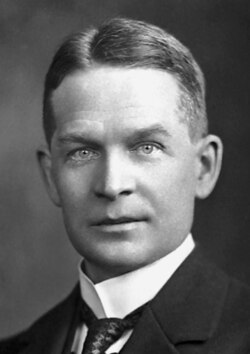

# Frederick Soddy

**Born:** 2 September 1877

**Died / status:** September 1956

**Fields:** Nuclear physics, Radiochemistry

Sourced portrait or photograph; see the image record for provenance and reuse conditions.

## Biography

A British radiochemist, Soddy studied radioactivity with Rutherford at McGill and later taught at Glasgow, Aberdeen and Oxford. His research on radioactive transformations and isotopes connected chemistry with nuclear physics and earned the 1921 Nobel Prize in Chemistry.

## Major contributions to physics

- Developed the radioactive-disintegration theory with Rutherford, identifying radioactivity with transformations of elements.
- Formulated the isotope concept: atoms with the same chemical properties can have different masses.
- Independently of Fajans and others, developed the radioactive-displacement law linking decay to positions in the periodic table.

## Historical and source notes

- Sources disagree on the day of death: Glasgow and Nobel records give 22 September 1956, while the Royal Society catalogue gives 26 September. The canonical date retains month precision pending confirmation from an original record.

## Image source and rights

- Source: [Original image record](https://commons.wikimedia.org/wiki/File:Frederick_Soddy.jpg)
- Creator / attribution: Unknown author
- License or rights statement: Public domain
- Local image: [d44810aef81664672985-39898beb20.jpg](../portraits/d44810aef81664672985-39898beb20.jpg)
- Credit: http://www.nobelprize.org/nobel_prizes/chemistry/laureates/1921/soddy.html

## Sources

- [University of Glasgow — Frederick Soddy](https://worldchanging.glasgow.ac.uk/notable-people/?id=89)
- [Royal Society — Frederick Soddy](https://makingscience.royalsociety.org/people/na8018/frederick-soddy)
- [Nobel Prize — Frederick Soddy](https://www.nobelprize.org/prizes/chemistry/1921/soddy/facts/)
- [Frederick Soddy — reference biography](https://en.wikipedia.org/wiki/Frederick_Soddy)

Record reviewed: 2026-10-26.
