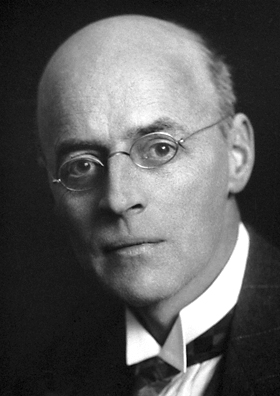

# Owen Willans Richardson

**Born:** 26 April 1879

**Died / status:** 15 February 1959

**Fields:** Electron physics, Thermionic emission

For the photographer or artist, date and type of image, consult the original image record.

## Biography

Owen Willans Richardson was born in Dewsbury, United Kingdom and conducted research in electron physics and thermionic emission. Nobel records list London University as the affiliation at the time of the award. They investigated the emission of electrons from hot materials. They were awarded the Nobel Prize in Physics in 1928.

## Major contributions to physics

- Investigated the emission of electrons from hot materials
- Developed a quantitative description of how thermionic current depends on temperature

**Nobel Prize in Physics:** 1928

## Image source and rights

- Source: [Original image record](https://commons.wikimedia.org/wiki/File:Owen_Richardson.jpg)
- Creator / attribution: Nobel foundation
- License or rights statement: Public domain
- Local image: [4e3c592fc73dfa4f9638.jpg](../portraits/4e3c592fc73dfa4f9638.jpg)
- Credit: http://nobelprize.org/nobel_prizes/physics/laureates/1928/richardson-bio.html

## Sources

- [Owen Willans Richardson - Facts](https://www.nobelprize.org/prizes/physics/1928/richardson/facts/)
- [Nobel Prize official laureate API, id 35](https://api.nobelprize.org/2.1/laureate/35)
- [Wikipedia: Owen Willans Richardson](https://en.wikipedia.org/wiki/Owen_Willans_Richardson)

Record reviewed: 2026-10-26.
