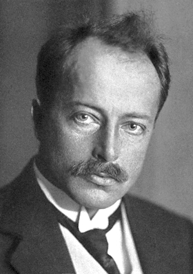

# Max von Laue

**Born:** 9 October 1879

**Died / status:** 24 April 1960

**Fields:** X-rays, Crystal physics

For the photographer or artist, date and type of image, consult the original image record.

## Biography

Max von Laue was born in Pfaffendorf, Germany and conducted research in X-rays and crystal physics. Nobel records list Frankfurt-on-the-Main University as the affiliation at the time of the award. They discovered the diffraction of X-rays by crystals. They were awarded the Nobel Prize in Physics in 1914.

## Major contributions to physics

- Discovered the diffraction of X-rays by crystals
- Provided evidence for both the wave nature of X-rays and periodic crystal structure

**Nobel Prize in Physics:** 1914

## Historical and source notes

- The date of death follows Humboldt University's archival biography: 24 April 1960. The Nobel structured data gives 23 April; this discrepancy was checked and the archival date adopted.

## Image source and rights

- Source: [Original image record](https://commons.wikimedia.org/wiki/File:Max_von_Laue_1914.jpg)
- Creator / attribution: Nobel foundation
- License or rights statement: Public domain
- Local image: [696ac47cf117369545b5.jpg](../portraits/696ac47cf117369545b5.jpg)
- Credit: http://nobelprize.org/nobel_prizes/physics/laureates/1914/laue-bio.html

## Sources

- [Max von Laue - Facts](https://www.nobelprize.org/prizes/physics/1914/laue/facts/)
- [Nobel Prize official laureate API, id 19](https://api.nobelprize.org/2.1/laureate/19)
- [Wikipedia: Max von Laue](https://en.wikipedia.org/wiki/Max_von_Laue)
- [Humboldt University archival biography of Max von Laue](https://www.lautarchiv.hu-berlin.de/en/objekte/-/9603/)

Record reviewed: 2026-10-26.
