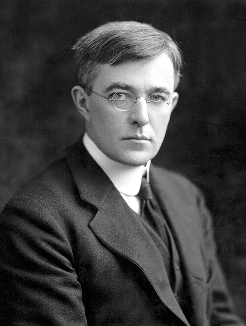

# Irving Langmuir

**Born:** 31 January 1881

**Died / status:** 16 August 1957

**Fields:** Plasma physics, Surface physics

Sourced photograph or portrait; the image record identifies its creator, provenance, and reuse conditions.

## Biography

An American physical chemist at General Electric's research laboratory, Langmuir applied atomic and molecular theory to materials, vacuum devices, and gas discharges. His surface-chemistry research earned the 1932 Nobel Prize in Chemistry.

## Major contributions to physics

- Developed monolayer adsorption theory and the Langmuir adsorption isotherm.
- Investigated ionized gases, helped establish the plasma concept, and developed Langmuir-probe diagnostics.
- Improved vacuum tubes and gas-filled incandescent lamps.

## Image source and rights

- Source: [Original image record](https://commons.wikimedia.org/wiki/File:Irving_Langmuir.jpg)
- Creator / attribution: Unknown author
- License or rights statement: Public domain
- Local image: [c455c9ba0bc71c6f070c.jpg](../portraits/c455c9ba0bc71c6f070c.jpg)
- Credit: http://pagesperso-orange.fr/philippe.boeuf/robert/portraits/langmuir.htm(Direct link to image) Edgar Fahs Smith Collection, University of Pennsylvania Library, Online

## Sources

- [Irving Langmuir — reference biography (en.wikipedia.org)](https://en.wikipedia.org/wiki/Irving_Langmuir)

Record reviewed: 2026-10-26.
