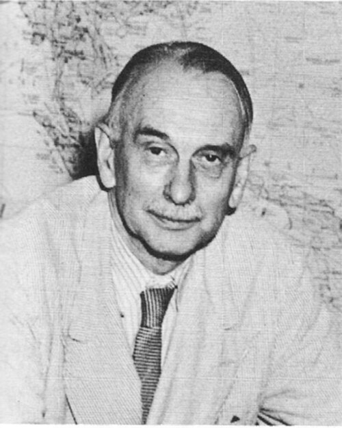

# Richard C. Tolman

**Born:** 4 March 1881

**Died / status:** 5 September 1948

**Fields:** Statistical physics, Relativistic cosmology

Sourced photograph or portrait; the image record identifies its creator, provenance, and reuse conditions.

## Biography

Tolman was an American theoretical physicist at Caltech and a wartime scientific adviser. He extended thermodynamics and statistical mechanics to relativistic settings and investigated the evolution of matter and radiation in cosmological models.

## Major contributions to physics

- Developed relativistic thermodynamics and the Tolman temperature-equilibrium relation in gravitational fields.
- Investigated the thermodynamics of expanding universes.
- Wrote influential treatments of classical and quantum statistical mechanics.

## Image source and rights

- Source: [Original image record](https://commons.wikimedia.org/wiki/File:Richard_C._Tolman.jpg)
- Creator / attribution: U. S. Army
- License or rights statement: Public domain
- Local image: [4557fd0a11dd20af6a90.jpg](../portraits/4557fd0a11dd20af6a90.jpg)
- Credit: Jones, Manhattan: The Army and the Bomb, p. 177

## Sources

- [Richard C. Tolman — reference biography (en.wikipedia.org)](https://en.wikipedia.org/wiki/Richard_C._Tolman)

Record reviewed: 2026-10-26.
