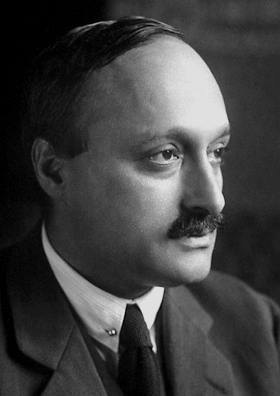

# James Franck

**Born:** 26 August 1882

**Died / status:** 21 May 1964

**Fields:** Atomic physics, Quantum experiments

For the photographer or artist, date and type of image, consult the original image record.

## Biography

James Franck was born in Hamburg, Germany and conducted research in atomic physics and quantum experiments. Nobel records list Goettingen University as the affiliation at the time of the award. They measured discrete atomic excitation energies through electron-atom collisions. They were awarded the Nobel Prize in Physics in 1925.

## Major contributions to physics

- Measured discrete atomic excitation energies through electron-atom collisions
- Provided direct experimental support for quantized atomic energy levels

**Nobel Prize in Physics:** 1925

## Image source and rights

- Source: [Original image record](https://commons.wikimedia.org/wiki/File:James_Franck_1925.jpg)
- Creator / attribution: Nobel foundation
- License or rights statement: Public domain
- Local image: [5f6dd1e293bc5af8150c.jpg](../portraits/5f6dd1e293bc5af8150c.jpg)
- Credit: http://nobelprize.org/nobel_prizes/physics/laureates/1925/franck-bio.html

## Sources

- [James Franck - Facts](https://www.nobelprize.org/prizes/physics/1925/franck/facts/)
- [Nobel Prize official laureate API, id 30](https://api.nobelprize.org/2.1/laureate/30)
- [Wikipedia: James Franck](https://en.wikipedia.org/wiki/James_Franck)

Record reviewed: 2026-10-26.
