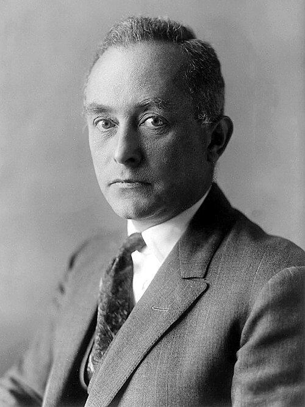

# Max Born

**Born:** 11 December 1882

**Died / status:** 5 January 1970

**Fields:** Quantum mechanics, Condensed-matter physics

For the photographer or artist, date and type of image, consult the original image record.

## Biography

Max Born was born in Breslau, Germany (now Wroclaw, Poland) and conducted research in quantum mechanics and condensed-matter physics. Nobel records list Edinburgh University as the affiliation at the time of the award. They introduced the probabilistic interpretation of the wavefunction. They were awarded the Nobel Prize in Physics in 1954.

## Major contributions to physics

- Introduced the probabilistic interpretation of the wavefunction
- Helped establish matrix mechanics and developed lattice dynamics

**Nobel Prize in Physics:** 1954

## Image source and rights

- Source: [Original image record](https://commons.wikimedia.org/wiki/File:Max_Born.jpg)
- Creator / attribution: See the original image record
- License or rights statement: [Public domain](https://commons.wikimedia.org/wiki/File:Max_Born.jpg)
- Local image: [9e5adf0065a1e5067059.jpg](../portraits/9e5adf0065a1e5067059.jpg)

## Sources

- [Max Born - Facts](https://www.nobelprize.org/prizes/physics/1954/born/facts/)
- [Nobel Prize official laureate API, id 61](https://api.nobelprize.org/2.1/laureate/61)
- [Wikipedia: Max Born](https://en.wikipedia.org/wiki/Max_Born)

Record reviewed: 2026-10-26.
