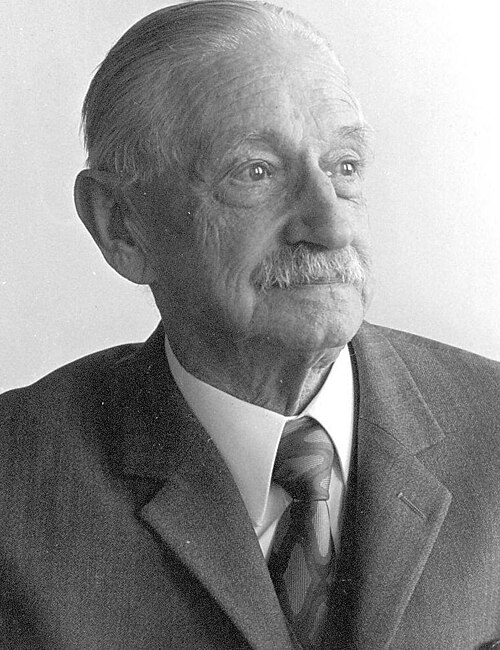

# Walther Meissner

**Born:** 16 December 1882

**Died / status:** 16 November 1974

**Fields:** Low-temperature physics, Superconductivity

Sourced portrait or photograph; see the image record for provenance and reuse conditions.

## Biography

A German experimentalist who worked in national metrology and Munich, Meissner investigated materials at low temperatures. His discovery with Ochsenfeld of magnetic-flux expulsion distinguished superconductivity from zero resistance alone.

## Major contributions to physics

- Discovered the Meissner effect with Ochsenfeld.
- Investigated low-temperature metallic transport and superconductivity.
- Developed cryogenic apparatus and precision measurements.

## Image source and rights

- Source: [Original image record](https://commons.wikimedia.org/wiki/File:Walther_Meissner.jpg)
- Creator / attribution: Wietek at German Wikipedia (Original text: Wietek)
- License or rights statement: Public domain
- Local image: [1685ea02478fbf2d4ee9-f63c6f6c7e.jpg](../portraits/1685ea02478fbf2d4ee9-f63c6f6c7e.jpg)
- Credit: Self-photographed

## Sources

- [Walther Meissner — institutional or reference biography (maglabweb.magnet.fsu.edu)](https://maglabweb.magnet.fsu.edu/magnet-academy/history-of-electricity-magnetism/pioneers/walther-meissner/)
- [Walther Meissner — institutional or reference biography (en.wikipedia.org)](https://en.wikipedia.org/wiki/Walther_Meissner)

Record reviewed: 2026-10-26.
