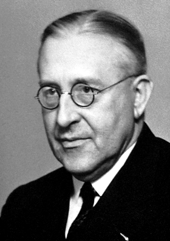

# Victor Franz Hess

**Born:** 24 June 1883

**Died / status:** 17 December 1964

**Fields:** Cosmic rays, Experimental physics

For the photographer or artist, date and type of image, consult the original image record.

## Biography

Victor Franz Hess was born in Peggau, Austria and conducted research in cosmic rays and experimental physics. Nobel records list Innsbruck University as the affiliation at the time of the award. They found that penetrating radiation increases at high altitude through balloon measurements. They were awarded the Nobel Prize in Physics in 1936.

## Major contributions to physics

- Found that penetrating radiation increases at high altitude through balloon measurements
- Provided crucial evidence that cosmic rays originate beyond Earth's atmosphere

**Nobel Prize in Physics:** 1936

## Image source and rights

- Source: [Original image record](https://commons.wikimedia.org/wiki/File:Hess.jpg)
- Creator / attribution: See the original image record
- License or rights statement: Public domain
- Local image: [6b3405d485f260d9df51.jpg](../portraits/6b3405d485f260d9df51.jpg)

## Sources

- [Victor F. Hess - Facts](https://www.nobelprize.org/prizes/physics/1936/hess/facts/)
- [Nobel Prize official laureate API, id 42](https://api.nobelprize.org/2.1/laureate/42)
- [Wikipedia: Victor Francis Hess](https://en.wikipedia.org/wiki/Victor_Francis_Hess)

Record reviewed: 2026-10-26.
