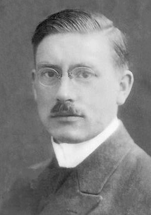

# Peter Debye

**Born:** 24 March 1884

**Died / status:** 2 November 1966

**Fields:** Solid-state physics, Molecular physics

Sourced photograph or portrait; the image record identifies its creator, provenance, and reuse conditions.

## Biography

A Dutch-born physicist, Debye held appointments at several European universities before moving to Cornell. His research spanned quantum theory, solid-state physics, and physical chemistry; work on molecular structure brought him the 1936 Nobel Prize in Chemistry.

## Major contributions to physics

- Developed the Debye model of crystalline heat capacity, including its low-temperature behaviour.
- Developed electrolyte theory with Erich Hückel.
- Helped establish powder X-ray diffraction and investigated molecular dipole moments.

## Image source and rights

- Source: [Original image record](https://commons.wikimedia.org/wiki/File:Debye100.jpg)
- Creator / attribution: Unknown author
- License or rights statement: [Public domain](https://commons.wikimedia.org/wiki/File:Debye100.jpg)
- Local image: [8f1af031118b1bf7276d.jpg](../portraits/8f1af031118b1bf7276d.jpg)
- Credit: http://chem.ch.huji.ac.il/~eugeniik/history/debye.html

## Sources

- [Peter Debye — reference biography (en.wikipedia.org)](https://en.wikipedia.org/wiki/Peter_Debye)

Record reviewed: 2026-10-26.
