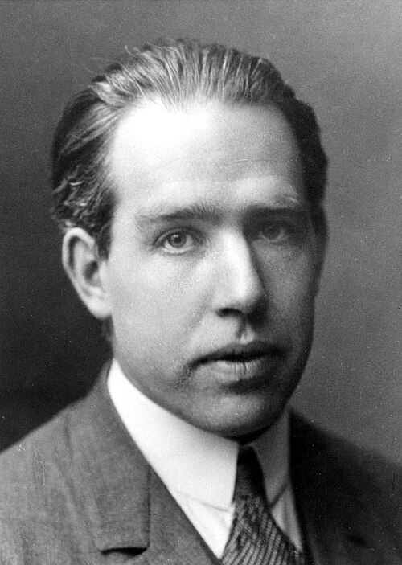

# Niels Henrik David Bohr

**Born:** 7 October 1885

**Died / status:** 18 November 1962

**Fields:** Atomic physics, Quantum theory

For the photographer or artist, date and type of image, consult the original image record.

## Biography

Niels Henrik David Bohr was born in Copenhagen, Denmark and conducted research in atomic physics and quantum theory. Nobel records list Copenhagen University as the affiliation at the time of the award. They proposed an atomic model with quantized energy levels that explained hydrogen spectra. They were awarded the Nobel Prize in Physics in 1922.

## Major contributions to physics

- Proposed an atomic model with quantized energy levels that explained hydrogen spectra
- Developed complementarity and contributed to the interpretation of quantum theory

**Nobel Prize in Physics:** 1922

## Image source and rights

- Source: [Original image record](https://commons.wikimedia.org/wiki/File:Niels_Bohr.jpg)
- Creator / attribution: The American Institute of Physics credits the photo [1] to AB Lagrelius & Westphal, which is the Swedish company used by the Nobel Foundation for most photos of its book series Les Prix Nobel.
- License or rights statement: [Public domain](https://commons.wikimedia.org/wiki/File:Niels_Bohr.jpg)
- Local image: [77681bee37b64ca6686b.jpg](../portraits/77681bee37b64ca6686b.jpg)
- Credit: Niels Bohr's Nobel Prize biography, from 1922

## Sources

- [Niels Bohr - Facts](https://www.nobelprize.org/prizes/physics/1922/bohr/facts/)
- [Nobel Prize official laureate API, id 27](https://api.nobelprize.org/2.1/laureate/27)
- [Wikipedia: Niels Bohr](https://en.wikipedia.org/wiki/Niels_Bohr)

Record reviewed: 2026-10-26.
