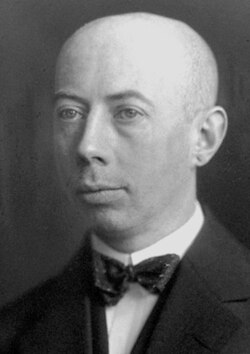

# Gustav Ludwig Hertz

**Born:** 22 July 1887

**Died / status:** 30 October 1975

**Fields:** Atomic physics, Quantum experiments

For the photographer or artist, date and type of image, consult the original image record.

## Biography

Gustav Ludwig Hertz was born in Hamburg, Germany and conducted research in atomic physics and quantum experiments. Nobel records list Halle University as the affiliation at the time of the award. They measured discrete atomic excitation energies through electron-atom collisions. They were awarded the Nobel Prize in Physics in 1925.

## Major contributions to physics

- Measured discrete atomic excitation energies through electron-atom collisions
- Provided direct experimental support for quantized atomic energy levels

**Nobel Prize in Physics:** 1925

## Image source and rights

- Source: [Original image record](https://commons.wikimedia.org/wiki/File:Gustav_Hertz.jpg)
- Creator / attribution: The American Institute of Physics credits the photo [1] to AB Lagrelius & Westphal, which is the Swedish printmaker used by the Nobel Foundation for most prints/engraving of its book series Les Prix Nobel.
- License or rights statement: Public domain
- Local image: [38f98373de7cf48395f6.jpg](../portraits/38f98373de7cf48395f6.jpg)
- Credit: http://nobelprize.org/nobel_prizes/physics/laureates/1925/hertz-bio.html

## Sources

- [Gustav Hertz - Facts](https://www.nobelprize.org/prizes/physics/1925/hertz/facts/)
- [Nobel Prize official laureate API, id 31](https://api.nobelprize.org/2.1/laureate/31)
- [Wikipedia: Gustav Ludwig Hertz](https://en.wikipedia.org/wiki/Gustav_Ludwig_Hertz)

Record reviewed: 2026-10-26.
