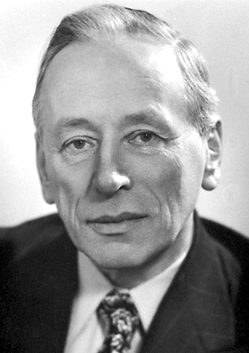

# Frits Zernike

**Born:** 16 July 1888

**Died / status:** 10 March 1966

**Fields:** Optics, Microscopy

For the photographer or artist, date and type of image, consult the original image record.

## Biography

Frits Zernike was born in Amsterdam, the Netherlands and conducted research in optics and microscopy. Nobel records list Groningen University as the affiliation at the time of the award. They invented phase-contrast microscopy. They were awarded the Nobel Prize in Physics in 1953.

## Major contributions to physics

- Invented phase-contrast microscopy
- Converted phase changes produced by transparent samples into visible intensity differences

**Nobel Prize in Physics:** 1953

## Image source and rights

- Source: [Original image record](https://commons.wikimedia.org/wiki/File:Zernike.jpg)
- Creator / attribution: Nobel foundation
- License or rights statement: Public domain
- Local image: [fac649d2f2ce646aa4ec.jpg](../portraits/fac649d2f2ce646aa4ec.jpg)
- Credit: http://nobelprize.org/nobel_prizes/physics/laureates/1953/zernike-bio.html

## Sources

- [Frits Zernike - Facts](https://www.nobelprize.org/prizes/physics/1953/zernike/facts/)
- [Nobel Prize official laureate API, id 60](https://api.nobelprize.org/2.1/laureate/60)
- [Wikipedia: Frits Zernike](https://en.wikipedia.org/wiki/Frits_Zernike)

Record reviewed: 2026-10-26.
