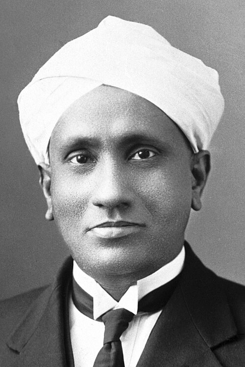

# Sir Chandrasekhara Venkata Raman

**Born:** 7 November 1888

**Died / status:** 21 November 1970

**Fields:** Optics, Spectroscopy

For the photographer or artist, date and type of image, consult the original image record.

## Biography

Sir Chandrasekhara Venkata Raman was born in Tiruchirappalli, India and conducted research in optics and spectroscopy. Nobel records list Calcutta University as the affiliation at the time of the award. They discovered frequency-shifted scattering of light, the Raman effect. They were awarded the Nobel Prize in Physics in 1930.

## Major contributions to physics

- Discovered frequency-shifted scattering of light, the Raman effect
- Established a method for investigating molecular and material structure through scattered light

**Nobel Prize in Physics:** 1930

## Image source and rights

- Source: [Original image record](https://commons.wikimedia.org/wiki/File:Sir_CV_Raman.JPG)
- Creator / attribution: Nobel Foundation
- License or rights statement: Public domain
- Local image: [67da8975592b13269e1f.jpg](../portraits/67da8975592b13269e1f.jpg)
- Credit: From Nobel Lectures, Physics 1922-1941, Elsevier Publishing Company, Amsterdam, 1965

## Sources

- [Sir Chandrasekhara Venkata Raman - Facts](https://www.nobelprize.org/prizes/physics/1930/raman/facts/)
- [Nobel Prize official laureate API, id 37](https://api.nobelprize.org/2.1/laureate/37)
- [Wikipedia: C. V. Raman](https://en.wikipedia.org/wiki/C._V._Raman)

Record reviewed: 2026-10-26.
