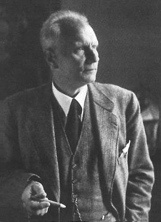

# Walther Gerlach

**Born:** 1 August 1889

**Died / status:** 10 August 1979

**Fields:** Atomic physics, Experimental physics

Sourced portrait or photograph; see the image record for provenance and reuse conditions.

## Biography

A German experimental physicist, Gerlach worked in Frankfurt, Tübingen and Munich. His atomic-beam experiment with Otto Stern provided direct evidence of space quantization. He also investigated radiation pressure, magnetism and spectroscopic analysis.

## Major contributions to physics

- Performed the split silver-atom-beam experiment with Stern, directly demonstrating quantized orientations of magnetic moments.
- Made precision measurements of radiation pressure with Alice Golsen.
- Studied ferromagnetism and developed chemical emission-spectroscopy methods.

## Historical and source notes

- The 1922 Stern–Gerlach experiment originally tested space quantization; a full interpretation involving electron spin followed in subsequent years.

## Image source and rights

- Source: [Original image record](https://en.wikipedia.org/wiki/File:Walther_Gerlach.jpg)
- Creator / attribution: See the original image record
- License or rights statement: Non-free historical photograph hosted by English Wikipedia under its fair-use rationale; that rationale does not grant a reusable image licence. Permission must be confirmed before website publication.
- Local image: [b9bf65f5315c38d12cb6-37348d0ddd.jpg](../portraits/b9bf65f5315c38d12cb6-37348d0ddd.jpg)
- Credit: University of Frankfurt physics portrait collection, reproduced on English Wikipedia; photographer unknown
- Republication: permission for use on a public website has not been verified. Confirm permission with the rightsholder or replace the image before publication.

## Sources

- [Deutsche Biographie — Walther Gerlach](https://www.deutsche-biographie.de/dbo053274.html)
- [Walther Gerlach — reference biography](https://en.wikipedia.org/wiki/Walther_Gerlach)

Record reviewed: 2026-10-26.
