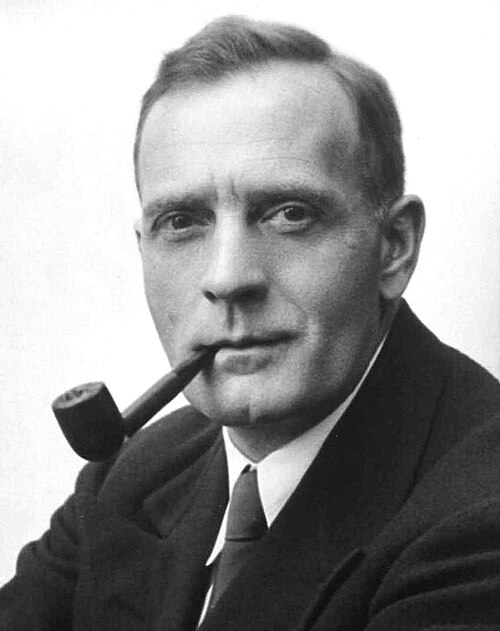

# Edwin Hubble

**Born:** 20 November 1889

**Died / status:** 28 September 1953

**Fields:** Observational cosmology, Extragalactic astronomy

Sourced photograph or portrait; the image record identifies its creator, provenance, and reuse conditions.

## Biography

An American astronomer at Mount Wilson Observatory, Hubble used large telescopes and Cepheid distance indicators to investigate nebulae. His work established galaxies beyond the Milky Way and helped make cosmic expansion a subject of observational astronomy.

## Major contributions to physics

- Used Cepheid distances to establish the extragalactic nature of the Andromeda nebula and other galaxies.
- Developed a morphological classification of galaxies.
- Combined galaxy-distance and redshift measurements to establish their approximately linear relation.

## Image source and rights

- Source: [Original image record](https://commons.wikimedia.org/wiki/File:Studio_portrait_photograph_of_Edwin_Powell_Hubble_%28cropped%29.JPG)
- Creator / attribution: Johan Hagemeyer (1884–1962)
- License or rights statement: Public domain
- Local image: [309a5823ce9312a848cd.jpg](../portraits/309a5823ce9312a848cd.jpg)
- Credit: http://hdl.huntington.org/cdm/ref/collection/p15150coll2/id/129

## Sources

- [Edwin Hubble — reference biography (en.wikipedia.org)](https://en.wikipedia.org/wiki/Edwin_Hubble)

Record reviewed: 2026-10-26.
