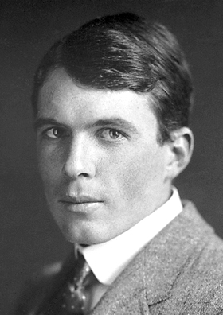

# William Lawrence Bragg

**Born:** 31 March 1890

**Died / status:** 1 July 1971

**Fields:** Crystallography, X-rays

For the photographer or artist, date and type of image, consult the original image record.

## Biography

William Lawrence Bragg was born in Adelaide, Australia and conducted research in crystallography and X-rays. Nobel records list Victoria University as the affiliation at the time of the award. They formulated Bragg's law relating X-ray wavelength, crystal-plane spacing and diffraction angle. They were awarded the Nobel Prize in Physics in 1915.

## Major contributions to physics

- Formulated Bragg's law relating X-ray wavelength, crystal-plane spacing and diffraction angle
- Co-founded X-ray crystal-structure analysis with William Henry Bragg

**Nobel Prize in Physics:** 1915

## Image source and rights

- Source: [Original image record](https://commons.wikimedia.org/wiki/File:Wl-bragg.jpg)
- Creator / attribution: Nobel foundation
- License or rights statement: Public domain
- Local image: [39bf20b9b3de9413fbfa.jpg](../portraits/39bf20b9b3de9413fbfa.jpg)
- Credit: http://nobelprize.org/nobel_prizes/physics/laureates/1915/wl-bragg-bio.html

## Sources

- [Lawrence Bragg - Facts](https://www.nobelprize.org/prizes/physics/1915/wl-bragg/facts/)
- [Nobel Prize official laureate API, id 21](https://api.nobelprize.org/2.1/laureate/21)
- [Wikipedia: William Lawrence Bragg](https://en.wikipedia.org/wiki/William_Lawrence_Bragg)

Record reviewed: 2026-10-26.
