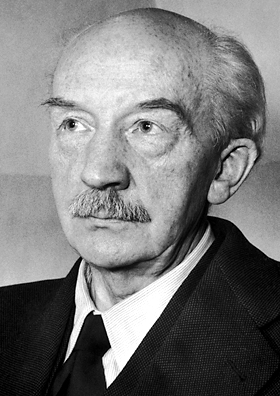

# Walther Bothe

**Born:** 8 January 1891

**Died / status:** 8 February 1957

**Fields:** Particle detection, Nuclear physics

For the photographer or artist, date and type of image, consult the original image record.

## Biography

Walther Bothe was born in Oranienburg, Germany and conducted research in particle detection and nuclear physics. Nobel records list University of Heidelberg and Max-Planck-Institut für medizinische Forschung as the affiliations at the time of the award. They developed the coincidence-counting method. They were awarded the Nobel Prize in Physics in 1954.

## Major contributions to physics

- Developed the coincidence-counting method
- Used timing correlations between detected events to investigate scattering and nuclear processes

**Nobel Prize in Physics:** 1954

## Image source and rights

- Source: [Original image record](https://commons.wikimedia.org/wiki/File:Bothe.jpg)
- Creator / attribution: Nobel foundation
- License or rights statement: Public domain
- Local image: [6b40adbb3b254b8d6490.jpg](../portraits/6b40adbb3b254b8d6490.jpg)
- Credit: http://nobelprize.org/nobel_prizes/physics/laureates/1954/bothe-bio.html

## Sources

- [Walther Bothe - Facts](https://www.nobelprize.org/prizes/physics/1954/bothe/facts/)
- [Nobel Prize official laureate API, id 62](https://api.nobelprize.org/2.1/laureate/62)
- [Wikipedia: Walther Bothe](https://en.wikipedia.org/wiki/Walther_Bothe)

Record reviewed: 2026-10-26.
