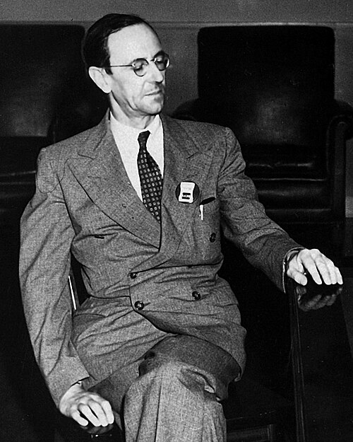

# James Chadwick

**Born:** 20 October 1891

**Died / status:** 24 July 1974

**Fields:** Nuclear physics, Experimental physics

For the photographer or artist, date and type of image, consult the original image record.

## Biography

James Chadwick was born in Manchester, United Kingdom and conducted research in nuclear physics and experimental physics. Nobel records list Liverpool University as the affiliation at the time of the award. They discovered the neutron and measured its basic properties. They were awarded the Nobel Prize in Physics in 1935.

## Major contributions to physics

- Discovered the neutron and measured its basic properties
- Established a foundation for understanding nuclear composition and neutron-induced reactions

**Nobel Prize in Physics:** 1935

## Image source and rights

- Source: [Original image record](https://commons.wikimedia.org/wiki/File:James_Chadwick.jpg)
- Creator / attribution: Los Alamos National Laboratory
- License or rights statement: Attribution
- Local image: [9747ded526e88625f38e.jpg](../portraits/9747ded526e88625f38e.jpg)
- Credit: Los Alamos National Laboratory

## Sources

- [James Chadwick - Facts](https://www.nobelprize.org/prizes/physics/1935/chadwick/facts/)
- [Nobel Prize official laureate API, id 41](https://api.nobelprize.org/2.1/laureate/41)
- [Wikipedia: James Chadwick](https://en.wikipedia.org/wiki/James_Chadwick)

Record reviewed: 2026-10-26.
