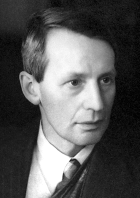

# George Paget Thomson

**Born:** 3 May 1892

**Died / status:** 10 September 1975

**Fields:** Quantum mechanics, Electron diffraction

For the photographer or artist, date and type of image, consult the original image record.

## Biography

George Paget Thomson was born in Cambridge, United Kingdom and conducted research in quantum mechanics and electron diffraction. Nobel records list London University as the affiliation at the time of the award. They observed the diffraction of electrons by crystals. They were awarded the Nobel Prize in Physics in 1937.

## Major contributions to physics

- Observed the diffraction of electrons by crystals
- Confirmed the wave properties of electrons predicted by matter-wave theory

**Nobel Prize in Physics:** 1937

## Image source and rights

- Source: [Original image record](https://commons.wikimedia.org/wiki/File:George_Paget_Thomson.jpg)
- Creator / attribution: Nobel foundation
- License or rights statement: Public domain
- Local image: [9bc9ff5106a55ef84576.jpg](../portraits/9bc9ff5106a55ef84576.jpg)
- Credit: http://nobelprize.org/nobel_prizes/physics/laureates/1937/thomson-bio.html

## Sources

- [George Paget Thomson - Facts](https://www.nobelprize.org/prizes/physics/1937/thomson/facts/)
- [Nobel Prize official laureate API, id 45](https://api.nobelprize.org/2.1/laureate/45)
- [Wikipedia: George Paget Thomson](https://en.wikipedia.org/wiki/George_Paget_Thomson)

Record reviewed: 2026-10-26.
